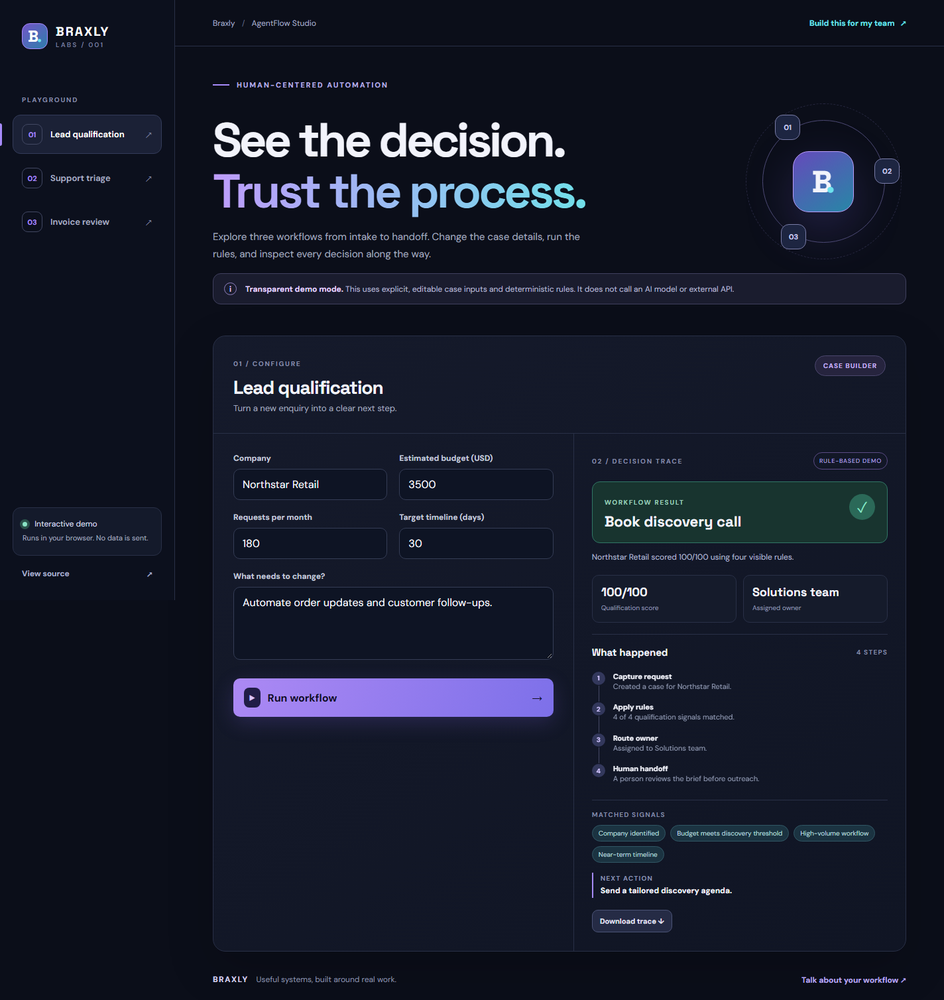

# AgentFlow Studio

An interactive automation workflow demo from [Braxly](https://github.com/braxlyco). Change a case, run it through visible rules, inspect the decision trace, and export the result.

**[Try the live demo](https://braxlyco.github.io/agentflow-studio/)**



## Explore the workflows

- **Lead qualification:** score an enquiry and route it to the right team.
- **Support triage:** detect service interruptions, assign priority, and choose an owner.
- **Invoice review:** flag duplicates, unmatched purchase orders, and high-value payments for human review.

Each run shows its matched signals, routing decision, owner, next action, and four-step trace. Invoice decisions can include a recorded human review. Exporting downloads the run as JSON.

## Demo boundary

This is a **rule-based, browser-only simulation**. It does not call an AI model, send data to a server, book meetings, issue payments, or contact customers. The human-review action records a local decision in the exported trace. A production implementation would connect the workflow to authenticated systems, an auditable backend, and an AI service where useful.

## Run locally

Serve this directory with any static file server, for example:

```bash
python -m http.server 5173
```

Open <http://localhost:5173>. ES modules need a local server rather than `file://`.

Run the rule tests with Node.js 24:

```bash
npm test
```

No dependencies, API keys, or build step are required.

## Structure

```text
index.html       App shell and accessible controls
styles.css       Responsive interface
src/engine.js    Workflow definitions and deterministic decisions
src/app.js       Form, trace, review, and JSON export interactions
tests/           Decision-rule tests
```

For a real automation project, contact [contactbraxly@gmail.com](mailto:contactbraxly@gmail.com).

MIT licensed. See [LICENSE](LICENSE).
